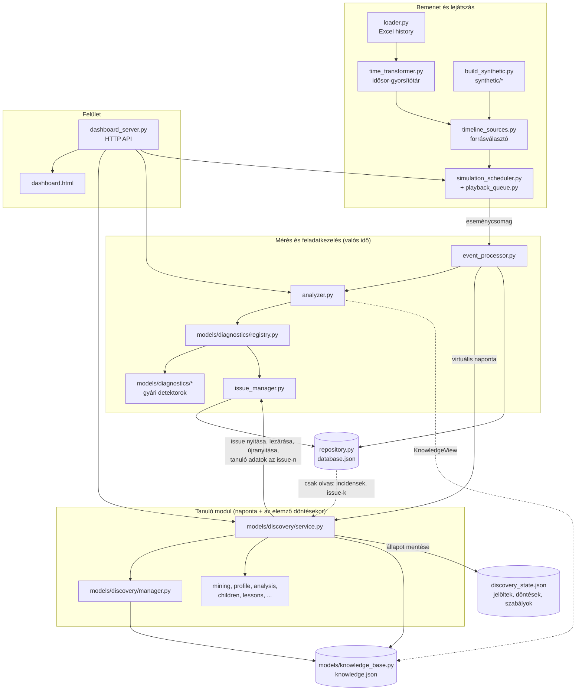
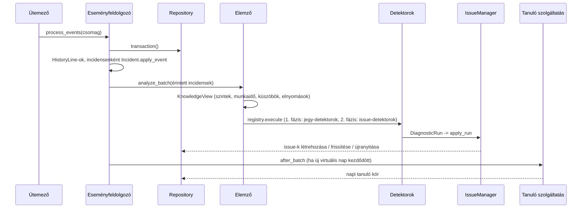
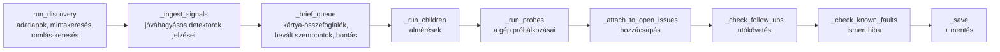
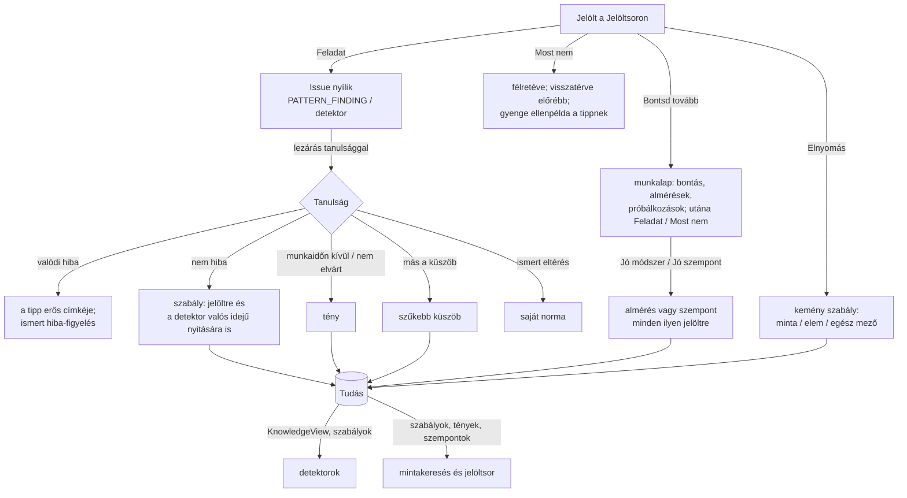
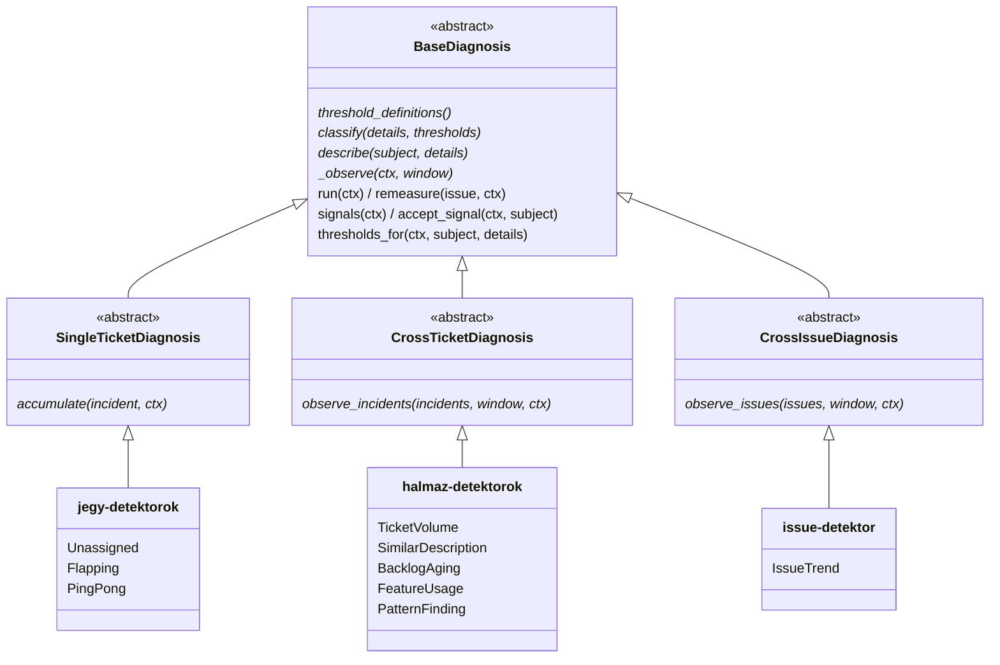
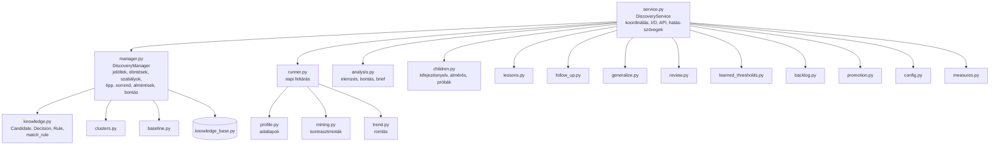

# Architektúra és fejlesztői leírás

Ez a dokumentum a rendszer felépítését írja le a kód mellé olvasva: milyen rétegekből áll, melyik modul mit csinál,
hogyan halad az adat a beérkező eseménytől a feladatig (issue), és hogyan tanul a rendszer az elemző döntéseiből.
A részletes szabályok (melyik diagnosztika mit mér, a döntések pontos hatása) a `docs/DIAGNOSTICS.md`-ben vannak;
a metódusok saját leírása (feladat és hívók, „Hívja:”) a forrásban.

A rendszer szakdolgozati MVP. A bemutatás és a validálás a valódi minta (kb. 270 jegy) és a beültetett hibákat
tartalmazó szintetikus idősor visszajátszásán, valamint a tanulási szimuláción alapul.

---

## 1. A rendszer egy mondatban

ServiceNow-incidensek változástörténetéből (history) mér, a szabályos eltéréseket **gyári detektorokkal** valós
időben feladattá (issue) alakítja, az ismeretlen összefüggéseket **mintakereséssel** naponta jelöltként az elemző
elé teszi, és az elemző döntéseiből (feladat, most nem, bontás, elnyomás, lezárási tanulság) **tanul**: a tanult
tudás visszahat a mintakeresésre és a detektorokra is.

## 2. Rétegek

| Réteg | Fő modulok | Felelősség |
|---|---|---|
| Bemenet és lejátszás | `loader.py`, `time_transformer.py`, `timeline_sources.py`, `simulation_scheduler.py`, `playback_queue.py`, `synthetic/` | A history-sorok előállítása (Excelből vagy szintetikusan) és időrendi lejátszása csomagokban, virtuális idővel. |
| Eseményfeldolgozás | `event_processor.py`, `models/history.py`, `models/incident.py` | Egy csomag sorait incidensekre alkalmazza, egy tranzakcióban elemeztet és ment. |
| Tárolás | `repository.py`, `models/knowledge_base.py`, `models/backup.py` | Az incidens-adatbázis (`database.json`), a tudástár (`knowledge.json`), a tanulási állapot (`discovery_state.json`) és a mentések. |
| Időértelmezés | `models/timeline.py`, `models/working_time.py` | A jegy útja egy pillanatig nézve: szakaszok (csoportonként), hold, felvétel, munkaidő. |
| Mérés és feladatkezelés | `analyzer.py`, `models/diagnostics/`, `issue_manager.py`, `models/issue.py` | Gyári detektorok futtatása, mérések, az issue-k életciklusa. |
| Tanuló modul | `models/discovery/` | Mintakeresés, jelöltek, döntések, szabályok, almérések, bontás, tanulságok, javaslatok. |
| Felület | `dashboard_server.py`, `dashboard.html` | HTTP API és egyoldalas felület (issue-k, incidensek, küszöbök, tanulás). |
| Eszközök | `learning_demo.py`, `backtest.py`, `tune.py`, `discovery_cli.py`, `synthetic/` | Tanulási szimuláció, backtest, paraméterhangolás, konzol. |

Indítás: `main.py` példányosítja és köti össze a komponenseket (repository, elemző, tanuló szolgáltatás,
eseményfeldolgozó, ütemező, webszerver). Az összekötés egyirányú: a felsőbb réteg kapja meg az alsóbbat, nem fordítva.
Az egyetlen visszacsatolás a tudás: a tanuló modul írja, az elemző olvassa (`KnowledgeView`), és az elemző a tanult
szabályokat egy visszahívón át kéri (`IncidentAnalyzer.rule_provider`).

## 3. Alapfogalmak és adatmodell

| Fogalom | Hol | Jelentés |
|---|---|---|
| History-sor | `models/history.py` (`HistoryLine`) | Egy mezőváltozás egy incidensen: ki, mikor, mit, miről mire. |
| Incidens | `models/incident.py` | A history-sorok és a belőlük levezetett mezők. A mérés nem a mostani mezőkből, hanem a history-ból dolgozik. |
| Idővonal, szakasz | `models/timeline.py` (`TicketTimeline`, `Stint`) | A jegy útja egy adott pillanatig (`as_of`); a szakasz az az időszak, amíg a jegy egy csoportnál volt. |
| Mérés (mintakereséshez) | `models/discovery/measures.py` | Egy egységre (jegy vagy szakasz) mért érték és a küszöb, amitől „érintett”: lassú felvétel, hosszú hold, ping-pong, SLA-eszkaláció, csoportonkénti felvétel és hold. |
| Adatlap (profile) | `models/discovery/profile.py` | Egy egység mezői (dimenziók) és mért értékei egy pillanatban; a mintakeresés és az elemzés ugyanebből dolgozik. |
| Minta, jelölt | `mining.py`, `knowledge.py` (`Candidate`) | Mezőérték-kombináció, ahol az érintettek aránya szignifikánsan magasabb; jelöltként az elemző elé kerül. |
| Jelzés | `kind="signal"` jelölt | Jóváhagyásos módban futó detektor túllépése, ugyanúgy jelöltként. |
| Issue (feladat) | `models/issue.py` | Egy detektor egy túllépése; állapotai: active, not_relevant, outdated, resolved, suppressed, declined, archived, deleted. |
| Döntés | `knowledge.py` (`Decision`) | Az elemző (vagy egy almérés) döntése egy jelöltről. |
| Szabály | `knowledge.py` (`Rule`) | Datalog-szerű elvető vagy kiemelő szabály mintaelemekre (`*` = a mező bármely értéke), mérésekre szűkíthető; a kemény szabály az erős jelöltet is rejti. |
| Tény | `knowledge_base.py` (`Fact`) | A világról szóló állítás (szint, munkaidő, nem dolgozik, elérhetőség, nem elvárt funkció). |
| Almérés | `children.py` (`ChildDef`) | Az elemző által tanított részmérés egy biztonságos kifejezésnyelven (ellenőrzés vagy csoportosítás). |
| Szűkebb küszöb | `core/threshold_overrides.py` | Egy detektor küszöbe egy hatókörre (csoport, útvonal, service): kézi vagy tanult. |
| Tanulság | `lessons.py` | Az issue lezárásakor adott magyarázat, amelyből tudás lesz. |

## 4. A valós idejű kör: eseménycsomagtól a feladatig

- **Eseményfeldolgozás** (`IncidentEventProcessor.process_events`): a sorokból `HistoryLine`, incidensenkénti
  csoportosítás, `Incident.apply_event` (a duplikátumot az incidens maga szűri), majd egy tranzakcióban elemzés és
  mentés. Ha az elemzés hibára fut, az issue-k visszaállnak a csomag előtti állapotra.
- **Elemző** (`IncidentAnalyzer`): a detektorok nyilvántartása, a küszöbök (`config/thresholds.py`, `database.json.thresholds.json`),
  a be/ki kapcsolás és a jóváhagyásos mód; minden futáshoz friss `KnowledgeView`-t ad.
- **Detektorok** (`models/diagnostics`): a közös keretrendszert a 6. fejezet írja le.
- **IssueManager** (`issue_manager.py`): egy futás eredményének átvezetése a detektor saját issue-ira. Túllépés: új
  issue vagy újra aktív; küszöb alatt: not_relevant; időablakos mérésnél, ha kiesett: outdated. Az elemző döntésével
  beállított állapotokat (resolved, suppressed…) a mérés nem írja felül; kivétel az **ismert hiba**: a „valódi hiba”
  tanulsággal lezárt issue elcsendesedés után újra túllépve ugyanabban a csomagban újranyílik.

## 5. A tanuló kör

### 5.1 Mikor fut

- **Naponta egyszer**, virtuális időben: az első csomag után, amely új napra lép (`DiscoveryService.after_batch`), a
  „Napvégéig” léptetésnél éjfélkor (`SimulationScheduler.step_day` → `discovery.run`), vagy kézzel.
- **Az elemző döntésekor**, azonnal: döntés, elnyomás, almérés, módszer-visszajelzés, issue-lezárás.

### 5.2 A napi kör lépései (`DiscoveryService._run`)

1. **Feltárás** (`runner.run_discovery`): az ablakban (alapból 7 nap) nyitott jegyek és szakaszok adatlapjai
   (`profile.build_profiles`), mérésenként mintakeresés (`mining.mine`) és romlás-keresés (`trend.mine_trends`), a
   jelöltek fogadása (`DiscoveryManager.ingest`): új vagy frissített jelölt, a „most nem”-ből visszatérő, az ismert
   eltérés normájához mérés, a szabályok alkalmazása, a tipp és a prioritás.
2. **Jelzések** (`_ingest_signals`): a jóváhagyásos módú detektorok túllépései jelöltként (`ingest_signals`).
3. **Összefoglalók** (`_brief_queue`): a kártya rövid elemzése (`analysis.analyze_candidate` → `brief`), a mérésnél
   bevált szempontok (`_good_dimension_insights`), a tovább bontott jelöltek „Mi jellemző még?” bontása.
4. **Almérések** (`_run_children`) a döntésre váró és a tovább bontott jelölteken; a teljesült automatikus
   magyarázat „most nem” döntést hoz; a riasztó almérés a tovább bontott jelöltet visszahozza.
5. **A gép próbálkozásai** (`_run_probes`) a tovább bontott jelölteken.
6. **Hozzácsapás**: a nyitott feladat mintájára illő új jelölt az issue-hoz kerül, nem a sorba.
7. **Utókövetés**: a lezárt issue „javult / nem javult”, „ismétlődött / nem” értékelése.
8. **Ismert hiba** (napi tartalék; a valós idejű ág az IssueManagerben).
9. **Mentés**: az állapot atomikus írása és a tudás datált másolata.

### 5.3 A döntés útja és a visszacsatolás

A tanulás három szintje:

- **Gyenge jelzés** (a sorrendet befolyásolja): a „most nem” (0,3 súlyú ellenpélda a tippben), a visszatérő „most
  nem” számlálója (előrébb sorol), a feladat megnyitása (nem címke).
- **Erős jelzés** (a tippet tanítja): a lezárás „valódi hiba” tanulsága (1,5 súly).
- **Tudás** (szabályt, tényt, almérést, küszöböt hoz létre): az elnyomás, a lezárási tanulság, a módszer- és
  szempont-visszajelzés, az elfogadott javaslat (tanult küszöb, munkaidő, általánosítás).

## 6. A gyári detektorok keretrendszere (`models/diagnostics/core`)

### 6.1 Az osztályszerkezet: absztrakt alap, három család, konkrét detektorok

A szerkezet háromszintű absztrakt osztályhierarchia, sablonmetódus (Template Method) mintára. A mérés vázát az alaposztály adja.
A család megmondja, **mit** figyel a detektor: egy jegy útját, jegyek halmazát vagy issue-k halmazát. A konkrét
detektor csak a saját mérését és besorolását írja meg.

Jelölés: a `*` **absztrakt metódus** (`@abstractmethod`): az alosztálynak kötelező megvalósítania, különben a Python nem engedi példányosítani (`TypeError`). A csillag nélküli metódusnak van alapértelmezett működése, felülírni nem kötelező. Az alsó dobozok a konkrét detektorok, a `…Diagnosis` utótag nélkül.

#### `BaseDiagnosis(ABC)` – a mérés váza (`models/diagnostics/core/base.py`)

Közös osztályattribútumok: `key` (a detektor azonosítója), `config_key` (a küszöbkonfiguráció kulcsa),
`issue_category`, `family`, `window_type`, `phase`, `triggers` (milyen eseményre fut), `review_by_default`
(alapból jóváhagyásos-e), `metric_key` / `metric_label` (a fő mért érték), `signal_label`.

| Csoport | Metódus | Feladat |
|---|---|---|
| **Az alosztály adja meg** | `threshold_definitions()`* | A küszöbök definíciója (név, alapérték, határok, leírás). |
| | `classify(details, thresholds)`* | Besorolás a mért adatokból: súlyosság, vagy `None`, ha nincs túllépés. |
| | `describe(subject, details)`* | Az issue szöveges leírása. |
| | `_observe(ctx, window)`* | A mérés: megfigyelések (`Observation`) az ablakban. A család valósítja meg, és helyette a saját absztrakt metódusát kéri a detektortól. |
| | `window_definitions()` | Az ablak paraméterei (hossz, vödörméret); alapból üres, mert NONE és SNAPSHOT ablaknál nincs ilyen. |
| **Paraméterek** | `thresholds(ctx)`, `window_params(ctx)`, `current_params(ctx)` | A globális küszöbök és ablakparaméterek a konfigurációból. |
| | `thresholds_for(ctx, subject, details)` | Az adott esetre érvényes küszöb: kézi szűkebb > tanult szűkebb > globális. |
| | `entity_items(subject, details)` | Az eset entitásai (csoport, útvonal, service…), amelyekre szűkebb küszöb vagy szabály illhet. |
| **Futtatás** | `run(ctx)` | Teljes mérés: a túllépések és a már issue-val rendelkező esetek mérése; jóváhagyásos módban és elnyomásnál nem nyit újat. |
| | `remeasure(issue, ctx)` | Egy issue újramérése a mostani paraméterekkel, a saját ablakához igazítva. |
| | `resolve_window(ctx)` | A mérési ablak a mérési pillanatból és az ablaktípusból. |
| | `_to_measurement(...)` | Megfigyelés → `Measurement` (azonosító, súlyosság, leírás, a használt küszöb forrása). |
| **Azonosítás** | `issue_id_for(occurrence)`, `occurrence_key(subject, window)` | Az issue azonosítója; TUMBLING ablaknál vödrönként külön előfordulás. |
| | `metric_value(details)` | A fő mért szám (a `metric_key` alapján). |
| **Tanuló körhöz** | `signals(ctx)` | Jóváhagyásos módban a túllépések, amelyekhez még nincs issue → jelöltek. |
| | `accept_signal(ctx, subject)` | Elfogadott jelzésből issue. |
| | `signal_items(subject, details)` | A jelzés leírása dimenzió–érték párokként (szabályokhoz, csoportosításhoz). |
| | `child_units(ctx)` | Almérésekhez: jelzésenként az érintett és az összehasonlító esetek; alapból nincs. |
| **Ellenőrzés** | `__init_subclass__` | Osztálydefiníciókor: egyedi `key`, alapértelmezett `config_key`, az ablaktípushoz kötelező ablakparaméter. |

#### A családok (`models/diagnostics/core/base.py`, a `BaseDiagnosis` alatt)

| Osztály | Beállítás | Metódus | Feladat |
|---|---|---|---|
| `SingleTicketDiagnosis` | `family=SINGLE_TICKET`, ablak: NONE, 1. fázis | `accumulate(incident, ctx)`* | A jegy eseményeinek bejárása időrendben; minden lépésnél az addigi mért adatok. |
| | | `initial_details(incident, ctx)` | A mért adatok kezdőértéke, ha még nincs releváns esemény. |
| | | `_observe` | Jegyenként egy megfigyelés: history-hivatkozások, a legutóbbi küszöbátlépés eseménye. |
| | | `_entity(incident, ctx)` | A jegy entitásai a mérés pillanatában (csoportok, útvonal, service, alkategória). |
| | | `signal_items` | A jegy és entitásai a tanuló körnek. |
| `CrossTicketDiagnosis` | `family=CROSS_TICKET`, ablak: alapból SLIDING, 1. fázis | `observe_incidents(incidents, window, ctx)`* | A jegyek halmazának mérése. |
| | | `is_eligible`, `is_activity`, `activity_events`, `incidents_in_window` | Jegykiválasztás: az ablakban releváns aktivitású, belépési feltételnek megfelelő jegyek. |
| `CrossIssueDiagnosis` | `family=CROSS_ISSUE`, ablak: SNAPSHOT, 2. fázis | `observe_issues(issues, window, ctx)`* | A többi detektor issue-inak mérése (a sajátjait nem látja). |

#### A konkrét detektorok (`models/diagnostics/<detektor>.py`, pl. `ping_pong.py`)

| Detektor | Család, ablak | Mit mér | Saját metódusok a kötelezőkön túl |
|---|---|---|---|
| `UnassignedDiagnosis` | jegy, NONE | Nyitott jegy megoldócsoport nélkül, és mióta. | `issue_id_for` (régi azonosítóformátum) |
| `FlappingDiagnosis` | jegy, NONE | Lezárás utáni visszanyitások száma. | `issue_id_for` |
| `PingPongDiagnosis` | jegy, NONE | Csoportváltások száma az L1-ből való továbbításon túl; külön az L1-be visszakerülés. | `issue_id_for`, `initial_details` |
| `TicketVolumeDiagnosis` | halmaz, TUMBLING | Az utolsó órás vödör nyitásai a korábbi napok azonos órájához képest (hétköznap és hétvége külön). | `_observe` |
| `SimilarDescriptionDiagnosis` | halmaz, SLIDING | Azonos (normalizált) rövid leírású, az ablakban nyitott jegyek halmozódása. | `_observe` |
| `BacklogAgingDiagnosis` | halmaz, SNAPSHOT | Felvétel nélkül váró jegyek csoportonként, munkaidőben. | `_observe`, `_age`, `signal_items`, `child_units`, `issue_id_for` |
| `FeatureUsageDiagnosis` | halmaz, SLIDING | Egy ServiceNow-funkció használata csoportonként, amikor alkalmazható lenne (katalógus: `config/feature_catalog.json`); alapból jóváhagyásos. | `_observe`, `_observation`, `_availability`, `signal_items`, `child_units` |
| `PatternFindingDiagnosis` | halmaz, SLIDING | Az elfogadott minták folyamatos újramérése adatlapokon. | `_observe`, `seed_run` (első mérés elfogadáskor), `observe_definition`, `window_profiles` |
| `IssueTrendDiagnosis` | issue, SNAPSHOT | Sok aktív issue egy kategóriában. | — |

**Megjegyzés a halmaz-detektorokról.** Mind az öt `CrossTicketDiagnosis` közvetlenül a `_observe`-ot írja felül,
mert maguk választják ki a jegyeket az idővonalból: nyitás ideje, nyitott szakasz, alkalmak, adatlapok. Az
`observe_incidents`-et üresen hagyják (a kódban megjegyzés jelzi). A család jegykiválasztását (`is_eligible`,
`activity_fields`, `incidents_in_window`) így jelenleg egyik detektor sem használja; a családból ténylegesen az
alapbeállítás (`family`, alapablak) és a közös besorolás számít.

### 6.2 A futtatás

- **Ablakok** (`core/window.py`): NONE (a jegy teljes élete), SNAPSHOT (állapotkép), SLIDING (csúszó), TUMBLING
  (igazított vödrök).
- **Fázisok** (`registry.py`): az 1. fázisban a jegyeken dolgozó detektorok futnak, a 2.-ban a `CrossIssueDiagnosis`
  családba tartozók. Minden futás eredménye azonnal az issue-kra kerül, így a 2. fázis már a frissített issue-kat látja.
  A regisztrálás (`DiagnosticRegistry.register`) csak `BaseDiagnosis` példányt fogad el, ütköző `key` vagy
  `config_key` nélkül.
- **Küszöb-feloldás** (`thresholds_for` → `threshold_overrides.resolve`): paraméterenként a kézi szűkebb küszöb az
  első, utána a tanult szűkebb, végül a globális. A mért eset entitásai (`entity_items`: csoportok, útvonal, service,
  alkategória…) döntik el, melyik szűkebb küszöb illik rá.
- **Jóváhagyásos mód** (`ctx.review`): a detektor nem nyit új issue-t, a túllépései jelzésként a jelöltsorba mennek
  (`signals`), a meglévő issue-k mérése folytatódik. Az elfogadott jelzésből `accept_signal` nyit issue-t.
- **Tanult elnyomás** (`core/suppression.py`): ha a túllépő esetre illik egy erre a detektorra szóló elvető
  szabály a tanuló körből, nem nyílik új issue (`run`). Az illesztés ugyanaz (`conditions_match`), mint a jelöltek
  szabályillesztésénél.

## 7. A tanuló modul belső szerkezete (`models/discovery`)

A modul három szerepre bomlik: egy **szolgáltatás** (koordinál, I/O, felület), egy **állapotkezelő** (a tanulási
állapot és a szabályok), és **tiszta függvények** (számolnak, nem írnak).

| Modul | Szerep |
|---|---|
| `service.py` | A tanuló kör szolgáltatása: a napi kör, a felület végpontjai (döntés, elnyomás, almérés, bontás, tanulság, javaslatok, mentés), a hatásablak szövegei, a tudás mentése. Az egyetlen hely, amely az adatbázishoz és a fájlokhoz nyúl. |
| `manager.py` | A tanulási állapot (`{candidates, decisions, rules, meta}`) kezelése: jelöltek fogadása, szabályok alkalmazása, tipp (súlyozott legközelebbi szomszéd), prioritás, döntések, almérések tárolása, bontási tudás, csatolás. Nem tud fájlról és adatbázisról. |
| `knowledge.py` | Az adatmodell (jelölt, döntés, szabály) és a szabályillesztés (`match_rule`). |
| `profile.py` | Ticket- és szakasz-adatlapok egy pillanatra, munkaidővel és keresési szempontként használt almérésekkel. |
| `mining.py` | Kontrasztminta-keresés (subgroup discovery): legfeljebb 2 elemű kombinációk, egyoldali binomiális próba, Benjamini–Hochberg FDR, külön családban a kontextusok (tovább bontott minták belseje) és a kiemelt mezők; a lefedett általánosabb minták kiesnek; a tiltott bontási utak nem jönnek. |
| `trend.py` | Romlás a saját múlthoz képest, a populáció változásával korrigálva. |
| `analysis.py` | Egy jelölt elemzése (összegzés, „mi köti össze”, napi arány, eloszlás, esetek), a kártya-összefoglaló, a „Mi jellemző még?” bontás. |
| `children.py` | Az almérés-nyelv (saját AST-értelmező, `eval` nélkül), a változók és függvények szókincse (idő, munkaidő, ráadó csoport…), az almérés futtatása (ellenőrzés vagy csoportosítás), a gyári próbák. |
| `lessons.py` | A lezárási tanulságok katalógusa és az űrlap alapértékei. |
| `follow_up.py` | Utókövetés indítása és értékelése. |
| `generalize.py` | Általánosítási javaslatok az ismétlődő döntésekből. |
| `review.py` | A szabályok és tények felülvizsgálata (régóta nem talált, ellentmond az adat). |
| `learned_thresholds.py` | Tanult küszöb-javaslatok a gyári detektorokhoz. |
| `baseline.py` | Ismert eltérés: a minta saját normája. |
| `clusters.py` | Közös részminták (családok) és hatókör. |
| `backlog.py` | A backlog-naptár adatai. |
| `promotion.py` | Az elfogadott mintából PATTERN_FINDING issue. |
| `runner.py`, `config.py`, `measures.py` | A napi feltárás összerakása, a paraméterek, a mérési katalógus. |

## 8. A tudás és a tárolás

| Fájl | Tartalom | Reset után |
|---|---|---|
| `database.json` | Incidensek (history-val), issue-k, issue-előzmény. | törlődik |
| `database.json.thresholds.json` | A detektorok globális küszöbei, ablakai, be/ki, jóváhagyásos mód. | megmarad |
| `knowledge.json` | Tények, almérések, szűkebb küszöbök, bontási tudás, tanulságok, utókövetések, elutasított javaslatok. | megmarad |
| `discovery_state.json` | Jelöltek, döntések, szabályok, számlálók. | a jelöltek és a döntések törlődnek, a **szabályok megmaradnak** |
| `config/discovery.json` | A tanuló modul paraméterei. | megmarad |
| `backups/` | A `knowledge.json` és a `discovery_state.json` datált másolatai (az utolsó 30, és napi 60 napig). | megmarad |

- A **`KnowledgeView`** (`KnowledgeBase.view`) a mérés pillanatában érvényes, csak olvasható tudás a detektoroknak
  és a mintakeresésnek: csoportszintek (L1), funkció-elérhetőség, keresési szempontként használt almérések,
  munkaidők (csoportonként, cégszintű alapértékkel: `GroupSchedules`), szűkebb küszöbök, és a tanuló kör elvető
  szabályai a detektoroknak (`suppressions`).
- **A tanuló modul és a `database.json`.** A tanuló modul saját állapota a `discovery_state.json` és a
  `knowledge.json`; a `database.json`-ba nem ment jelöltet, döntést vagy szabályt. Az incidens-adatbázist
  **csak olvassa** (incidensek és history, ebből készülnek az adatlapok; az issue-k állapota). Az issue-kra hatnak
  a döntései, de ezt is az `IssueManager` végzi, a tanuló modul nem ír közvetlenül az issue-kba:
  - issue nyitása, lezárása, újranyitása (`apply_run`, `apply_action`, a küszöb alatti elfogadott mintánál
    `open_issue`): az elfogadott jelzésből vagy mintából feladat lesz (`_accept_signal`, `promote_finding`), a
    tanulsággal lezárt issue megoldottá válik, az ismert hiba és a „nem javult” utókövetés újranyit;
  - a tanuló kör adatai az issue `details` mezőjében (`update_details`): `lesson` (lezárási tanulság),
    `follow_up` (utókövetés), `attached` és `attached_news` (hozzácsapott új jelöltek), `known_fault_quiet_since`
    és `known_fault_returned_at` (ismert hiba); ezeket a mérés frissítése nem írja felül (`KEPT_DETAIL_KEYS`);
  - a tények (munkaidő, nem elvárt funkció…) változása után az összes issue újramérése az elemzőn át
    (`reanalyze_all`), hogy a detektorok az új tudással mérjenek.

  Így az issue-kat egyetlen komponens írja (`IssueManager`); az incidenseket és a history-t a tanuló modul soha
  nem módosítja.
- Az írás atomikus (ideiglenes fájl, majd csere); a repository tranzakciója zárral védett, a szerver és a
  lejátszás ugyanazt a példányt használja.

## 9. Felület és API

A `dashboard_server.py` egy szabványkönyvtári HTTP-szerver (`ThreadingHTTPServer`), a `dashboard.html` egyoldalas,
keretrendszer nélküli JavaScript-felület. A Tanulás nézet fülei: Jelöltsor (kártyák, a jelölt saját oldala),
Backlog-naptár, Javaslatok, Tudás, Paraméterek.

| Végpont | Módszer | Szolgáltatás |
|---|---|---|
| `/api/summary`, `/api/incidents[/id]`, `/api/issues[/id]` | GET | áttekintés, incidensek, issue-k |
| `/api/issues/bulk-action`, `/api/issues/lesson` | POST | issue-műveletek, lezárás tanulsággal |
| `/api/thresholds[/schema]`, `/api/thresholds/update`, `/api/diagnostics/toggle`, `/api/diagnostics/review` | GET/POST | detektor-küszöbök, be/ki, jóváhagyásos mód |
| `/api/simulation…` | GET/POST | lejátszás vezérlése (indítás, szünet, napvégéig, forrásváltás, reset) |
| `/api/discovery` | GET | a Jelöltsor adatai (`overview`) |
| `/api/discovery/candidates/<id>[/analysis]` | GET | a jelölt és az elemzése |
| `/api/discovery/knowledge`, `/review`, `/config`, `/children`, `/backlog` | GET | Tudás, Javaslatok, Paraméterek, almérések, naptár |
| `/api/discovery/decide`, `/suppress`, `/unrefine` | POST | a jelölt műveletei és az elnyomás |
| `/api/discovery/children`, `/breakdown` | POST | almérés, módszer- és szempont-visszajelzés |
| `/api/discovery/fact`, `/rule`, `/availability` | POST | tények és szabályok |
| `/api/discovery/schedule`, `/generalize`, `/threshold-override` | POST | javaslatok elfogadása, elutasítása |
| `/api/discovery/config`, `/run`, `/backup` | POST | paraméter, kézi feltárás, mentés és visszaállítás |

A tanuló végpontok válaszában az `effect` mező írja le a döntés hatását a mintakeresésre; a felület ezt felugró
ablakban mutatja.

## 10. Tervezési döntések

- **Mérés a history-ból, egy pillanatra nézve.** Minden mérés `as_of` időpontra számol az idővonalból, nem az
  incidens mostani mezőiből: így a visszajátszás determinisztikus, és bármely korábbi állapot újramérhető.
- **Virtuális idő.** A tanulási állapot ideje a mérés ideje, nem a valós óra; ha a lejátszás ideje visszaugrik, a
  jelöltek újraindulnak, a tudás marad.
- **Szakaszonkénti mérés.** A csoporthoz köthető mérés (felvétel, hold) a csoportnál töltött szakaszra vonatkozik,
  mert a jegyet tipikusan a központi L1 nyitja, és onnan kerül a megoldócsoportokhoz.
- **Ember a körben.** A mintakeresés nem nyit magától issue-t; a gép javasol, az elemző dönt. A detektorok valós
  időben nyitnak issue-t, de a tanult tudás (szabály, küszöb, munkaidő) rájuk is hat.
- **Három művelet a jelöltön.** Feladat, Most nem, Bontsd tovább; a tudást adó döntések az elnyomás és az
  issue-lezárás tanulsága. A tanulás erőssége a döntés megalapozottságát követi (megnyitás < most nem < lezárás).
- **Kemény szabály és biztonsági szelep.** Az elnyomás az erős jelöltet is rejti, ezért a Javaslatok elején jelez, ha
  egy elnyomás alatt nagyon erős eltérés jelenik meg.
- **Magyarázhatóság.** Minden jelöltnél látszik, mit mér, mi a küszöb, mi a minta szavakban; minden döntés után a
  hatása; minden tudáselem visszavonható, és a tudás menthető és visszaállítható.
- **Egyszerű tárolás.** JSON-fájlok (MVP); a tárolás a repositoryban és a tudástárban van elkülönítve, így
  adatbázisra cserélhető.
- **Biztonságos kifejezésnyelv.** Az almérés saját AST-értelmezővel fut (csak a megengedett műveletek, változók és
  függvények), `eval` nélkül.

## 11. Bővítés

- **Új gyári detektor**: a `docs/DIAGNOSTICS.md` „Új diagnosztika – ellenőrzőlista” szerint: osztály a
  `models/diagnostics` alá (a három család egyikéből), `threshold_definitions`, `classify`, `describe`, és a
  család absztrakt metódusa (`accumulate`, `observe_incidents` vagy `observe_issues`); regisztrálás az `analyzer.py`-ban. Ha jóváhagyásos módban is
  fut, adjon `signal_label`-t, gazdag `signal_items`-t, és ha lehet, `child_units`-ot.
- **Új mérés a mintakereséshez**: `MeasureDef` a `models/discovery/measures.py`-ban, az értéke az adatlapon
  (`profile.py`), a küszöbe a paraméterek közt (`config.py`).
- **Új almérés-változó vagy függvény**: egy `_var_…` / `_fn_…` függvény és egy sor a `VARIABLES` / `FUNCTIONS`
  táblában (`children.py`); a felület szókincs-súgója magától frissül.
- **Új gyári próba** (a gép próbálkozásai): egy sor a `PROBES` vagy a `GROUP_PROBES` táblában.
- **Új lezárási tanulság**: a `lessons.py` katalógusa és a `DiscoveryService.close_issue_with_lesson` ága.

## 12. Tesztelés és validálás

- **Egységtesztek** (`tests/`, `python -m unittest discover -s tests`): a mérések, a detektorok, a mintakeresés, a
  tudás, a döntések, az almérések, a tanulság, a mentés és a szolgáltatás végpontjai.
- **Szintetikus adat** (`build_synthetic.py`, `synthetic/generator.py`, `synthetic/faults.py`): valódi incidensek
  újramintavételezésével készült előtörténet, beültetett hibákkal és megoldókulccsal.
- **Backtest és hangolás** (`backtest.py`, `tune.py`): mikor és mennyi zajjal jelennek meg a beültetett hibák.
- **Tanulási szimuláció** (`learning_demo.py`, `synthetic/learning_sim.py`): egy szimulált elemző a mostani menet
  szerint dönt, egy tanulás nélküli kör az összehasonlító alap; az eredmény a döntésszám, a megtalált hibák ideje és
  a tipp egyezése.
