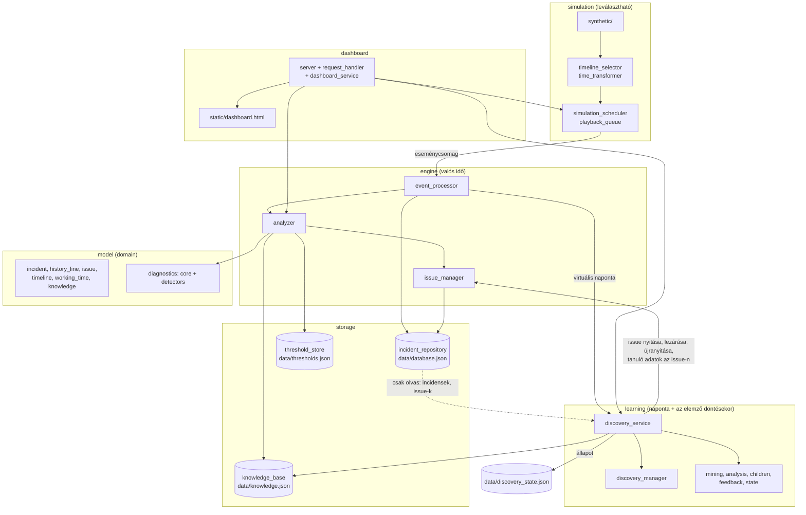
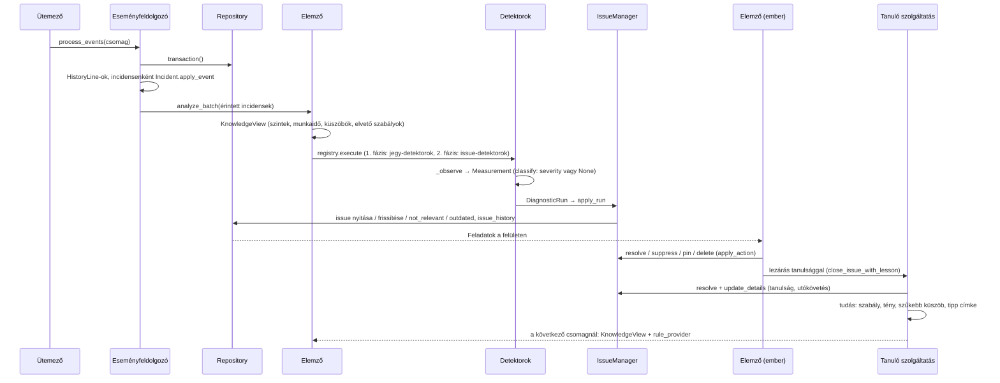
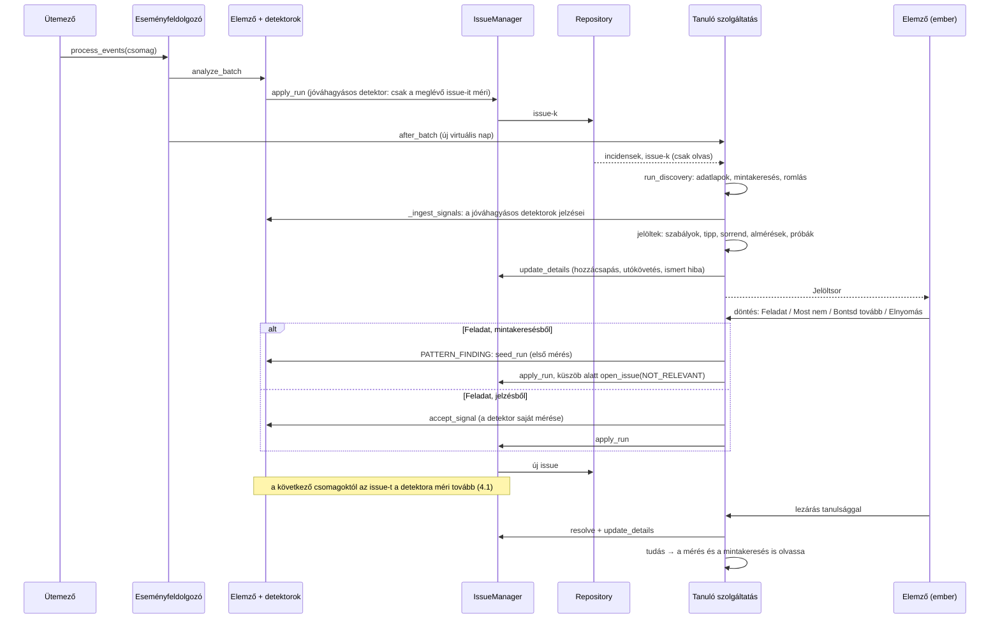
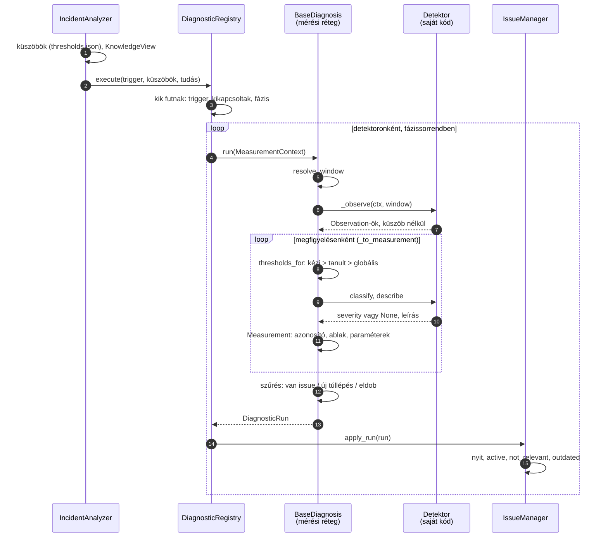
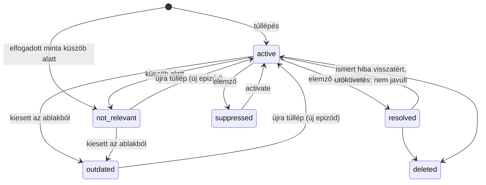
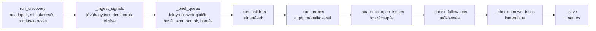
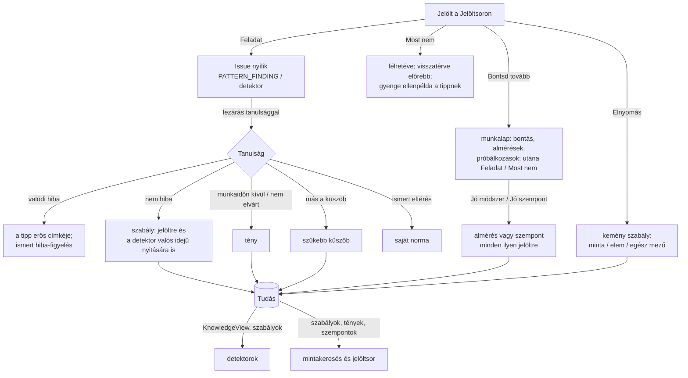
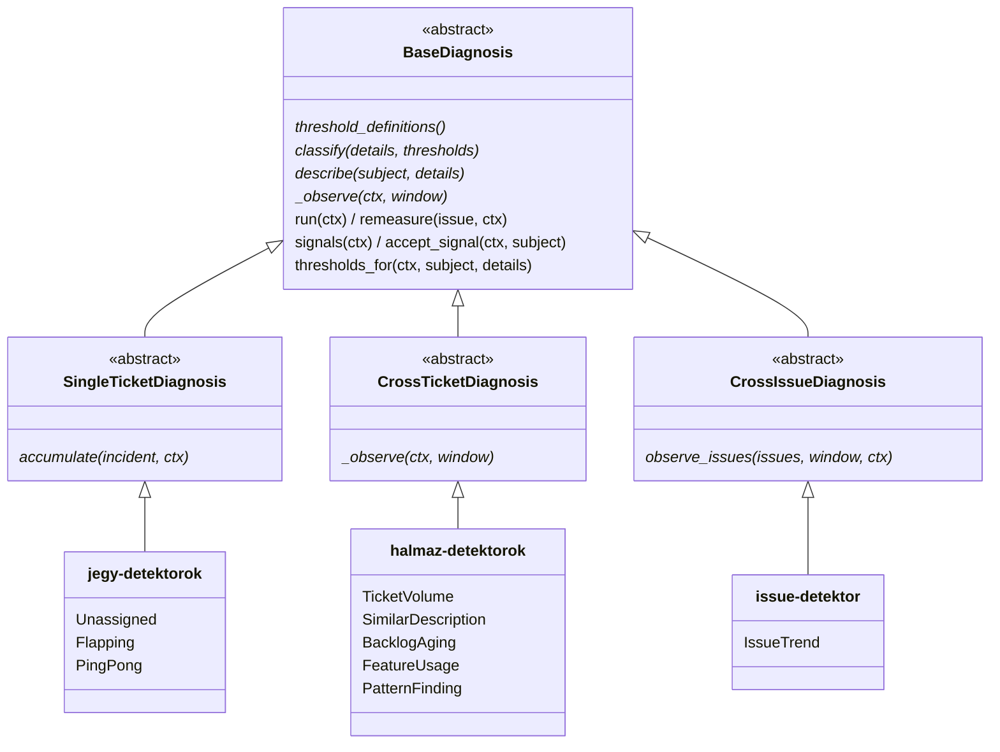
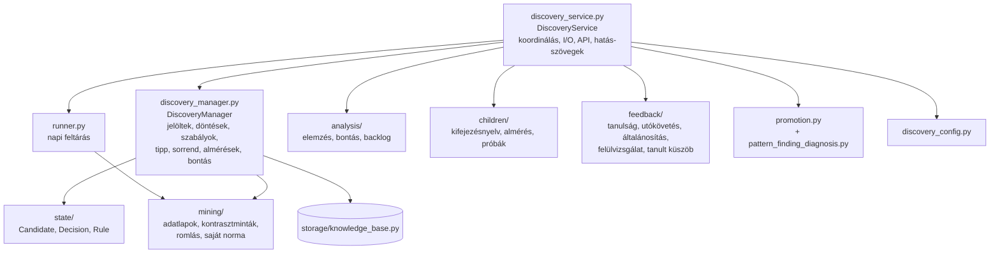

# Architektúra és fejlesztői leírás

Ez a dokumentum a rendszer felépítését írja le a kód mellé olvasva: milyen rétegekből áll, melyik modul mit csinál,
hogyan halad az adat a beérkező eseménytől a feladatig (issue), és hogyan tanul a rendszer az elemző döntéseiből.
A részletes szabályok (melyik diagnosztika mit mér, a döntések pontos hatása) a `docs/DIAGNOSTICS.md`-ben vannak;
a metódusok saját leírása (feladat és hívók, „Hívja:”) a forrásban.

A rendszer szakdolgozati MVP. A bemutatás és a validálás a valódi minta (kb. 270 jegy) és a beültetett hibákat
tartalmazó szintetikus idősor visszajátszásán, valamint a tanulási szimuláción alapul.

---

## 1. A rendszer egy mondatban

ServiceNow-incidensek változástörténetéből (history) mér, a szabályos eltéréseket **gyári detektorokkal** valós
időben feladattá (issue) alakítja, az ismeretlen összefüggéseket **mintakereséssel** naponta jelöltként az elemző
elé teszi, és az elemző döntéseiből (feladat, most nem, bontás, elnyomás, lezárási tanulság) **tanul**: a tanult
tudás visszahat a mintakeresésre és a detektorokra is.

## 2. Csomagok és rétegek

### 2.1 Könyvtárszerkezet

Minden logikai modul külön csomag; egy fájlban egy fő osztály van, mellette csak a hozzá tartozó kis típusok
(enumok, paraméter- és eredménytípusok), segédfüggvények és konstansok. A tiszta számoló modulok (pl. a mintakeresés) függvénymodulok, témánként almappában.

```
main.py                     indítás: a komponensek példányosítása és összekötése
config/                     paths.py (minden útvonal egy helyen), discovery.json (a tanuló modul paraméterei)
model/                      a domain – semmitől nem függ
  incident.py, history_line.py, issue.py, issue_state.py, severity_level.py
  timeline/                 a jegy útja egy pillanatig: ticket_timeline.py, stint.py, interval.py, field_change.py,
                            fields.py (mezőnevek, állapotok), timeline_builder.py (felépítés a history-ból)
  working_time/             munkarend: schedule.py, schedule_suggestion.py, schedule_inference.py
  knowledge/                a tudás modellje: fact.py, knowledge_view.py, group_schedules.py, predicates.py, …
  diagnostics/              a gyári detektorok
    core/                   a keretrendszer: base_diagnosis.py, a három család, measurement*.py, window_type.py, …
    detectors/              a konkrét detektorok (feature_usage/ saját almappában)
    diagnostic_registry.py  nyilvántartás és futtatás
storage/                    tárolók és betöltők: incident_repository.py, knowledge_base.py, threshold_store.py,
                            excel_loader.py, backup.py, json_cleaning.py, errors.py
engine/                     a valós idejű feldolgozás: event_processor.py, analyzer.py, issue_manager.py
learning/                   a tanuló modul
  discovery_service.py, discovery_manager.py, runner.py, discovery_config.py, promotion.py,
  pattern_finding_diagnosis.py (az elfogadott minták detektora)
  state/                    jelölt, döntés, szabály és állapotaik
  mining/                   adatlapok, mérések, kontrasztminta-keresés, romlás, saját norma, családok
  analysis/                 a jelölt elemzése, backlog-naptár
  children/                 almérések: kifejezésnyelv, változók, futtatás, próbák
  feedback/                 tanulságok, utókövetés, általánosítás, felülvizsgálat, tanult küszöbök
dashboard/                  server.py, request_handler.py, dashboard_service.py, launcher.py, static/dashboard.html
simulation/                 leválasztható: lejátszás és kísérletek
  time_transformer.py, timeline_selector.py, playback_queue.py, simulation_scheduler.py
  synthetic/                szintetikus adat: generator.py, faults.py, compare.py, build_synthetic.py
  experiments/              backtest, hangolás, tanulási szimuláció
tools/                      discovery_cli.py (konzol), scripts/
data/                       a futás adatai (nincs a repóban): ld. data/README.md
tests/                      a csomagszerkezetet tükrözi; közös tesztadatok: tests/support/
docs/                       ez a leírás, DIAGNOSTICS.md, ROADMAP.md, notebooks/
```

### 2.2 Rétegek és függések



| Csomag | Felelősség | Függ |
|---|---|---|
| `model` | A domain: incidens, history-sor, issue, a jegy idővonala, munkarend, a tudás modellje (`KnowledgeView`), a gyári detektorok és keretrendszerük. | semmitől |
| `storage` | Fájlba írás és olvasás: incidens-adatbázis, tudástár, küszöbök, Excel-betöltő, mentések. | `model` |
| `engine` | Egy eseménycsomag feldolgozása: incidensek frissítése, a detektorok futtatása, az issue-k életciklusa. | `model`, `storage`, és a `learning`-ből egyetlen osztály: a `PatternFindingDiagnosis` regisztrálásához |
| `learning` | Mintakeresés, jelöltek, döntések, szabályok, almérések, bontás, tanulságok, javaslatok. | `model`, `storage`; az elemzőt és az `IssueManager`-t példányként kapja (`main.py`), nem importálja |
| `dashboard` | HTTP API és egyoldalas felület. | a fentiek |
| `simulation` | Lejátszás (valódi vagy szintetikus idősor, virtuális idővel), szintetikus adat, kísérletek. A maghoz csak visszahívásokkal kapcsolódik; nélküle a mag és a felület is fut. | a fentiek |
| `tools` | Konzolos eszközök. | a fentiek |

Indítás: `main.py` példányosítja és köti össze a komponenseket (repository, elemző, tanuló szolgáltatás,
eseményfeldolgozó, ütemező, webszerver). Az összekötés egyirányú: a felsőbb réteg kapja meg az alsóbbat, nem fordítva.
Az egyetlen visszacsatolás a tudás: a tanuló modul írja, az elemző olvassa (`KnowledgeView`), és az elemző a tanult
szabályokat egy visszahívón át kéri (`IncidentAnalyzer.rule_provider`). Az útvonalak egy helyen vannak:
`config/paths.py` (`PROJECT_ROOT`, `CONFIG_DIR`, `DATA_DIR`, `DASHBOARD_HTML`).

## 3. Alapfogalmak és adatmodell

| Fogalom | Hol | Jelentés |
|---|---|---|
| History-sor | `model/history_line.py` (`HistoryLine`) | Egy mezőváltozás egy incidensen: ki, mikor, mit, miről mire. |
| Incidens | `model/incident.py` | A history-sorok és a belőlük levezetett mezők. A mérés nem a mostani mezőkből, hanem a history-ból dolgozik. |
| Idővonal, szakasz | `model/timeline/` (`TicketTimeline`, `Stint`) | A jegy útja egy adott pillanatig (`as_of`); a szakasz az az időszak, amíg a jegy egy csoportnál volt. |
| Mérés (mintakereséshez) | `learning/mining/measures.py` | Egy egységre (jegy vagy szakasz) mért érték és a küszöb, amitől „érintett”: lassú felvétel, hosszú hold, ping-pong, SLA-eszkaláció, csoportonkénti felvétel és hold. |
| Adatlap (profile) | `learning/mining/profiles.py` (`TicketProfile`, `ProfileSet`) | Egy egység mezői (dimenziók) és mért értékei egy pillanatban; a mintakeresés és az elemzés ugyanebből dolgozik. |
| Minta, jelölt | `learning/mining/contrast_mining.py`, `learning/state/candidate.py` | Mezőérték-kombináció, ahol az érintettek aránya szignifikánsan magasabb; jelöltként az elemző elé kerül. |
| Jelzés | `kind="signal"` jelölt | Jóváhagyásos módban futó detektor túllépése, ugyanúgy jelöltként. |
| Issue (feladat) | `model/issue.py`, `model/issue_state.py` | Egy detektor egy túllépése; állapotai: active, not_relevant, outdated, resolved, suppressed, archived, deleted. |
| Döntés | `learning/state/decision.py` | Az elemző (vagy egy almérés) döntése egy jelöltről. |
| Szabály | `learning/state/rule.py` | Datalog-szerű elvető vagy kiemelő szabály mintaelemekre (`*` = a mező bármely értéke), mérésekre szűkíthető; a kemény szabály az erős jelöltet is rejti. |
| Tény | `model/knowledge/fact.py` | A világról szóló állítás (szint, munkaidő, nem dolgozik, elérhetőség, nem elvárt funkció). |
| Almérés | `learning/children/child_def.py` (`ChildDef`) | Az elemző által tanított részmérés egy biztonságos kifejezésnyelven (ellenőrzés vagy csoportosítás). |
| Szűkebb küszöb | `model/diagnostics/core/threshold_override.py` | Egy detektor küszöbe egy hatókörre (csoport, útvonal, service): kézi vagy tanult. |
| Tanulság | `learning/feedback/lessons.py` | Az issue lezárásakor adott magyarázat, amelyből tudás lesz. |

## 4. A valós idejű kör: eseménycsomagtól a feladatig

### 4.1 Eseményfolyam csak a gyári detektorokkal

A detektorok önállóan nyitnak issue-t; a tanuló modul ebben a körben nem dönt semmiről. A kör végén az issue-k
lezárása (tanulsággal) és a felületi műveletek tudást hoznak létre, és ez a következő csomag mérését már befolyásolja.



### 4.2 Eseményfolyam a tanuló körrel

Itt két út vezet issue-hoz a detektor saját nyitásán kívül: a jóváhagyásos módú detektor jelzése és a mintakeresés
jelöltje. Mindkettő a Jelöltsoron át, az elemző „Feladat” döntésével lesz issue, és az issue-t ekkor is az
`IssueManager` nyitja.



### 4.3 A mérési réteg: a detektor és az issue között (`model/diagnostics/core`)

A detektor nem nyit issue-t, és nem is tud róla. Csak annyit mond meg, hogy **mit lát** és **mitől baj**. A kettő
között egy mérési réteg áll, amely a detektor megállapításából egységes, besorolt mérést készít. A mérésből az
`IssueManager` csinál issue-t. A rétegen át csak **változtathatatlan értékobjektumok** (`frozen` dataclass) mennek,
így egy futás semmit nem tud elrontani a másikban, és a lépések külön-külön tesztelhetők.

Ki mit csinál egy futásban, sávonként (oszloponként) egy szereplő, a lépések felülről lefelé, sorszámozva.



A szűrés (a `run` utolsó lépése):

| Mérés | Mi lesz vele |
|---|---|
| a detektornak már van issue-ja erre | mindig továbbmegy, küszöb alatt is (az állapotot ez vezérli) |
| új túllépés | továbbmegy, ha a detektor nincs jóváhagyásos módban, és nincs rá tanult elvető szabály |
| új túllépés jóváhagyásos módban | itt kimarad; a napi tanuló kör `signals()`-szal jelzésként veszi fel a Jelöltsorra |
| új, küszöb alatt | eldobva |

A detektor két ponton szól bele: **mit mér** (`_observe`) és **mitől baj** (`classify`, `describe`). Minden más a
mérési rétegé, az előkészítés az `IncidentAnalyzer`-é és a `DiagnosticRegistry`-é, az issue sorsa az
`IssueManager`-é.

**A négy objektum:**

| Objektum | Mit hordoz | Ki készíti |
|---|---|---|
| `MeasurementContext` | A futás bemenete: trigger, mérési pillanat (`measured_at`, virtuális idő), incidensek, a látható issue-k (a kikapcsolt detektoroké nem), a detektor saját küszöbei és ablakparaméterei, a csomag eseményei, a tudás (`KnowledgeView`), és hogy jóváhagyásos-e a mód (`review`). | a nyilvántartás (`_base_context` → `for_diagnostic`) |
| `Observation` | Amit a detektor egy subjectről megállapít, **küszöbtől függetlenül**: `details` (a mért számok), `affected`, `history_refs`, `trigger_ref` (a küszöbátlépés eseménye). | a detektor `_observe`-ja |
| `Measurement` | A besorolt megfigyelés: identitás (`issue_id`, `occurrence_key`, `subject`), `severity`, metrika, leírás, a felhasznált küszöb forrása, az ablak és a paraméterek pillanatképe. | a réteg `_to_measurement`-je |
| `DiagnosticRun` | Egy futás mérései, az ablak, és a hatókör (`scope`): `None` esetén a detektor minden issue-ja, különben csak a felsoroltak. | a réteg `run`, `remeasure`, `accept_signal` metódusai |

**Egy mérés lépései:**

1. **Ablak** (`resolve_window`): a mérési pillanatból és az ablaktípusból. NONE: a jegy teljes élete. SNAPSHOT:
   állapotkép. SLIDING: `[most − visszatekintés, most]`. TUMBLING: az utoljára lezárult, egész órához (stb.)
   igazított vödör.
2. **Megfigyelés** (`_observe`, a detektor vagy a családja): subjectenként egy `Observation`, küszöb nélkül.
3. **Küszöb az esetre** (`thresholds_for`): a megfigyelés entitásai (`details["entity"]`: csoport, útvonal,
   service…) alapján paraméterenként a kézi szűkebb, a tanult szűkebb, végül a globális küszöb.
4. **Besorolás és leírás** (`classify`, `describe`): a detektor tiszta függvényei; csak a `details`-ből és a
   küszöbökből dolgoznak.
5. **Mérés összeállítása** (`_to_measurement`):
   - az azonosító (`occurrence_key`, `issue_id`);
   - a metrika;
   - a felhasznált szűkebb küszöb és a forrása (`threshold_source`, `thresholds_used`), ha nem a globális döntött;
   - az ablak és a paraméterek pillanatképe.
6. **Szűrés** (`run`):
   - a detektor meglévő issue-jának mérése mindig továbbmegy, küszöb alatt is, mert az állapotot ez vezérli;
   - új túllépés csak akkor megy tovább, ha a detektor nincs jóváhagyásos módban, és nem illik rá tanult elvető
     szabály;
   - a küszöb alatti, issue nélküli mérés elmarad.

**Szerződés** (`observation.py`, `measurement.py`):

- **A `severity is None` csak azt jelenti, hogy a mérés küszöb alatt maradt.** Nem mérhető subjectről (nincs adat,
  nem tartozik az ablakba) a detektor nem ad megfigyelést, így a „nem mérhető” és a „rendben van” nem keveredik.
- **A `details` szabad kulcsú, néhány foglalt kulccsal:**
  - `entity`: a szűkebb küszöbhöz és az elvető szabályhoz;
  - `groups`: az issue csoportlistája;
  - a réteg tölti: `threshold_source`, `thresholds_used`;
  - az issue tölti: `measured_exceeded` és a tanuló kör kulcsai (`KEPT_DETAIL_KEYS`).

**Belépési pontok.** Négy belépési pont van, mind ugyanarra a magra épül (`_observe` → `_to_measurement`, a `run`
és a `signals` közös része a `_measure_all`):

| Belépés | Mikor | Eredmény |
|---|---|---|
| `run(ctx)` | csomag, kézi futtatás, ki- és bekapcsolás | a teljes mérés `DiagnosticRun`-ja |
| `remeasure(issue, ctx)` | paraméterváltozás után az aktív issue-ra | egy mérés az issue saját, átméretezett ablakában; a hatókör csak ez az issue |
| `signals(ctx)` | a tanuló kör napi lépése, jóváhagyásos detektoron | a túllépések, amelyekhez nincs issue; pontosan azok, amelyekből jóváhagyás nélkül issue lenne |
| `accept_signal(ctx, subject)` | „Feladat” egy jelzésen | egy subject mérése `DiagnosticRun`-ként, a jóváhagyásos módot megkerülve |

A PATTERN_FINDING ehhez egy ötödiket ad (`seed_run`): az elfogadott minta első mérését, amikor az issue még nem
létezik, így a definíciót sem lehet még az issue-ból olvasni.

### 4.4 Az issue objektum felépítése (`model/issue.py`)

Az issue mindig egy mérésből születik (`Issue.from_measurement`, új epizóddal), és minden későbbi mérés ugyanígy
frissíti (`issue.apply_measurement`). Az issue a mérés életciklussal bővített, tárolt változata.

**Az azonosító.** `issue_id = "ISSUE-<diagnostic_key>-<sha1(occurrence_key)[:12]>"` (`make_issue_id`, az egyetlen
azonosító-képző). Az `occurrence_key` alapból a subject (pl. egy csoport vagy egy jegy). TUMBLING ablaknál
`subject|vödör kezdete`, tehát vödrönként külön issue jön. Ugyanaz a jelenség ezért mindig ugyanazt az issue-t
frissíti, nem nyit újat.

| Mezőcsoport | Mezők | Honnan | Mikor íródik |
|---|---|---|---|
| Identitás | `issue_id`, `diagnostic_key`, `occurrence_key`, `subject` | a mérés | nyitáskor; utána nem változik |
| Besorolás | `category`, `family`, `affected_type` (incidens / szakasz / issue) | a detektor osztályszintű adatai | minden mérésnél |
| Eredmény | `severity`, `metric_value`, `description` | `classify`, `metric_value`, `describe` | minden mérésnél |
| Bizonyíték | `affected_objects`, `history_refs`, `groups` | az `Observation` | minden mérésnél (felülírja) |
| Mérési keret | `measured_at`, `window_type`, `window_start`, `window_end`, `params_snapshot` | a futás ablaka és paraméterei | minden mérésnél |
| Epizód | `trigger`, `first_detected_at`, `trigger_ref` | a nyitó mérés | csak új epizódnál: nyitáskor és újranyitáskor |
| Életciklus | `state`, `is_pinned`, `is_deleted`, `params_changed`, `updated_at` | az `IssueManager` | állapotváltáskor, felületi műveletnél |
| Részletek | `details` | a detektor adatai + a tanuló kör adatai | lásd lent |

**A `details` két forrásból áll.** A detektor a saját adatait adja (pl. csoportszám, lánc, a használt szűkebb küszöb:
`threshold_source`, `thresholds_used`), és ezeket minden mérés lecseréli. A tanuló kör és az elemző adatai
(`KEPT_DETAIL_KEYS`: `lesson`, `follow_up`, `attached`, `attached_news`, `known_fault_quiet_since`,
`known_fault_returned_at`) az újramérésnél megmaradnak. Ezek mellé a mérés beírja a `measured_exceeded` jelzőt.
Erre azért van szükség, mert lezárt issue-nál a `severity` nem mondja meg, hogy a legutóbbi mérés túllépett-e. A
PATTERN_FINDING issue-nál a `details` hordozza magát a mintadefiníciót is (`measure`, `pattern`, `bad_threshold`,
`candidate_id`).

**Állapotok** (`model/issue_state.py`) három csoportban:

| Csoport | Állapot | Ki állítja |
|---|---|---|
| Mérés vezérli | `active` (túllépés), `not_relevant` (mérve, küszöb alatt), `outdated` (időablakos mérés, kiesett az ablakból) | `apply_run` |
| Az elemző döntése | `resolved`, `suppressed`, `deleted` | `apply_action` (felület, tanulságos lezárás) |
| Befagyasztott | `archived` | a modell ismeri (`archive`, not_relevant állapotból); a mérés nem nyúl hozzá. Jelenleg egyik út sem állítja be: a valós futásban felgyűlő issue-k időszakos archiválásához van fenntartva. |



Az állapotátmeneteket maga az objektum őrzi (`mark_outdated`, `mark_not_relevant`, `resolve`, `suppress`,
`activate`, `delete`): mindegyik csak a megengedett állapotokból lép, a törölthöz pedig nem nyúl. Minden változás egy
sort kap az `issue_history`-ban (régi és új állapot, ok, metrika, mérési idő). Ebből rajzolja a felület az issue
történetét, és ebből számol a backtest.

### 4.5 Az IssueManager feladata (`engine/issue_manager.py`)

Az `IssueManager` az **egyetlen író** az issue-kon. A detektorok csak méréseket adnak vissza (`DiagnosticRun`), a
tanuló modul csak olvassa az adatbázist, és minden issue-változást ezen az osztályon át kér. Így az életciklus
szabályai egy helyen vannak, és minden változás bekerül az `issue_history`-ba.

| Metódus | Hívja | Mit csinál |
|---|---|---|
| `apply_run(db, run, reason)` | a nyilvántartás minden futás után; a tanuló kör elfogadáskor | Egy futás átvezetése a detektor **saját** issue-ira (`diagnostic_key` szerint). |
| `apply_param_change(db, diagnostic, ctx, reason)` | az elemző küszöb- vagy ablakváltozáskor | Ablak nélkül teljes újramérés. Időablakos mérésnél az aktív issue-k a saját ablakukban mérődnek újra; a not_relevant és outdated issue-k csak `params_changed` jelzést kapnak. Utána a mostani ablak teljes mérése következik az új küszöbbel. |
| `apply_action(db, ids, action, reason)` | felület, tanulságos lezárás, utókövetés, ismert hiba | Az elemző műveletei: `resolve`, `suppress`, `activate`, `delete`, `pin`, `unpin`. |
| `open_issue(db, measurement, state, reason)` | `promotion.promote_finding` | Nyitás megadott állapotban akkor is, ha a mérés nem lépte át a küszöböt, mert az elemző döntött róla. Meglévő issue-hoz nem nyúl. |
| `update_details(db, id, values, remove)` | a tanuló szolgáltatás | A tanuló kör adatainak írása a `details`-be, állapotváltás nélkül. |

**Az `apply_run` szabályai**, mérésenként:

1. **Nincs még issue:** ha a mérés túllép, `Issue.from_measurement` új issue-t nyit `active` állapotban és új
   epizóddal; ha nem lép túl, nem történik semmi.
2. **Befagyasztott vagy törölt issue** (`archived`, `deleted`): nem nyúl hozzá.
3. **Az elemző döntésével lezárt issue** (`resolved`, `suppressed`): frissülnek a mérési adatok, az állapot nem
   változik. Kivétel az **ismert hiba**: a „valódi hiba” tanulsággal lezárt issue, ha a mérése egyszer küszöb alá
   csendesedett (`known_fault_quiet_since`), majd újra túllép, új epizóddal újranyílik (`known_fault_returned_at`).
4. **Mérés vezérelte issue:** túllépésnél `active`, és ha előtte nem volt az, új epizódot kap. Küszöb alatt
   `not_relevant` lesz.

Ezután jönnek a futás **hatókörébe tartozó, de a mérésből hiányzó** issue-k (`_absent_state`):

- SLIDING ablaknál `outdated` (kiesett az ablakból);
- TUMBLING ablaknál `outdated`, ha egy már lezárt vödörhöz tartozik;
- ablak nélküli mérésnél `not_relevant`.

A hatókör alapból a detektor összes issue-ja; célzott újramérésnél (`remeasure`, `accept_signal`) csak az érintett
issue.

**Ami nem az `IssueManager` dolga:** hogy mely mérések jutnak el egyáltalán az `apply_run`-ig (jóváhagyásos mód,
elvető szabály, küszöb alatti új eset). Ezt a mérési réteg szűri (4.3, 6. lépés).

### 4.6 Az issue nyitásának útjai

| Út | Kiváltja | Lánc | Kezdőállapot |
|---|---|---|---|
| Detektor túllépése | eseménycsomag, kézi futtatás, paraméterváltozás | `BaseDiagnosis.run` → `apply_run` | `active` |
| Elfogadott jelzés | „Feladat” egy jóváhagyásos detektor jelzésén | `DiscoveryService._accept_signal` → `diagnostic.accept_signal` → `apply_run` | `active` |
| Elfogadott minta | „Feladat” egy mintakeresés-jelölten | `promote_finding` → `PatternFindingDiagnosis.seed_run` → `apply_run`, küszöb alatt `open_issue` | `active` vagy `not_relevant` |
| Újranyitás | újra túllépő mérés, ismert hiba, „nem javult” utókövetés, `activate` | `apply_run` vagy `apply_action` | `active`, új epizóddal |

A nyitás után minden issue-t a saját detektora mér tovább minden csomagnál, ugyanazokkal a szabályokkal (4.5). Ez
igaz az elfogadott jelzésből és mintából nyílt issue-ra is.

### 4.7 A kör szereplői

- **Eseményfeldolgozás** (`IncidentEventProcessor.process_events`): a sorokból `HistoryLine`, incidensenkénti
  csoportosítás, `Incident.apply_event` (a duplikátumot az incidens maga szűri), majd egy tranzakcióban elemzés és
  mentés. Ha az elemzés hibára fut, az issue-k visszaállnak a csomag előtti állapotra.
- **Elemző** (`IncidentAnalyzer`): a detektorok nyilvántartása, a küszöbök (`storage/threshold_store.py`, `data/thresholds.json`),
  a be/ki kapcsolás és a jóváhagyásos mód; minden futáshoz friss `KnowledgeView`-t ad.
- **Detektorok** (`model/diagnostics`): a közös keretrendszert a 6. fejezet írja le.
- **IssueManager** (`engine/issue_manager.py`): az issue-k egyetlen írója; a szabályait a 4.5 írja le.

## 5. A tanuló kör

### 5.1 Mikor fut

- **Naponta egyszer**, virtuális időben: az első csomag után, amely új napra lép (`DiscoveryService.after_batch`), a
  „Napvégéig” léptetésnél éjfélkor (`SimulationScheduler.step_day` → `discovery.run`), vagy kézzel.
- **Az elemző döntésekor**, azonnal: döntés, elnyomás, almérés, módszer-visszajelzés, issue-lezárás.

### 5.2 A napi kör lépései (`DiscoveryService._run`)



1. **Feltárás** (`runner.run_discovery`): az ablakban (alapból 7 nap) nyitott jegyek és szakaszok adatlapjai
   (`profile.build_profiles`), mérésenként mintakeresés (`mining.mine`) és romlás-keresés (`trend.mine_trends`), a
   jelöltek fogadása (`DiscoveryManager.ingest`): új vagy frissített jelölt, a „most nem”-ből visszatérő, az ismert
   eltérés normájához mérés, a szabályok alkalmazása, a tipp és a prioritás.
2. **Jelzések** (`_ingest_signals`): a jóváhagyásos módú detektorok túllépései jelöltként (`ingest_signals`).
3. **Összefoglalók** (`_brief_queue`): a kártya rövid elemzése (`analysis.analyze_candidate` → `brief`), a mérésnél
   bevált szempontok (`_good_dimension_insights`), a tovább bontott jelöltek „Mi jellemző még?” bontása.
4. **Almérések** (`_run_children`) a döntésre váró és a tovább bontott jelölteken; a teljesült automatikus
   magyarázat „most nem” döntést hoz; a riasztó almérés a tovább bontott jelöltet visszahozza.
5. **A gép próbálkozásai** (`_run_probes`) a tovább bontott jelölteken.
6. **Hozzácsapás**: a nyitott feladat mintájára illő új jelölt az issue-hoz kerül, nem a sorba.
7. **Utókövetés**: a lezárt issue „javult / nem javult”, „ismétlődött / nem” értékelése.
8. **Ismert hiba** (napi tartalék; a valós idejű ág az IssueManagerben).
9. **Mentés**: az állapot atomikus írása és a tudás datált másolata.

### 5.3 A döntés útja és a visszacsatolás



A tanulás három szintje:

- **Gyenge jelzés** (a sorrendet befolyásolja): a „most nem” (0,3 súlyú ellenpélda a tippben), a visszatérő „most
  nem” számlálója (előrébb sorol), a feladat megnyitása (nem címke).
- **Erős jelzés** (a tippet tanítja): a lezárás „valódi hiba” tanulsága (1,5 súly).
- **Tudás** (szabályt, tényt, almérést, küszöböt hoz létre): az elnyomás, a lezárási tanulság, a módszer- és
  szempont-visszajelzés, az elfogadott javaslat (tanult küszöb, munkaidő, általánosítás).

## 6. A gyári detektorok keretrendszere (`model/diagnostics/core`)

### 6.1 Az osztályszerkezet: absztrakt alap, három család, konkrét detektorok

A szerkezet háromszintű absztrakt osztályhierarchia, sablonmetódus (Template Method) mintára. A mérés vázát az alaposztály adja.
A család megmondja, **mit** figyel a detektor: egy jegy útját, jegyek halmazát vagy issue-k halmazát. A konkrét
detektor csak a saját mérését és besorolását írja meg.



Jelölés: a `*` **absztrakt metódus** (`@abstractmethod`): az alosztálynak kötelező megvalósítania, különben a Python nem engedi példányosítani (`TypeError`). A csillag nélküli metódusnak van alapértelmezett működése, felülírni nem kötelező. Az alsó dobozok a konkrét detektorok, a `…Diagnosis` utótag nélkül.

#### `BaseDiagnosis(ABC)` – a mérés váza (`model/diagnostics/core/base_diagnosis.py`)

Közös osztályattribútumok: `key` (a detektor azonosítója), `config_key` (a küszöbkonfiguráció kulcsa),
`issue_category`, `family`, `window_type`, `phase`, `triggers` (milyen eseményre fut), `review_by_default`
(alapból jóváhagyásos-e), `metric_key` / `metric_label` (a fő mért érték), `signal_label`.

| Csoport | Metódus | Feladat |
|---|---|---|
| **Az alosztály adja meg** | `threshold_definitions()`* | A küszöbök definíciója (név, alapérték, határok, leírás). |
| | `classify(details, thresholds)`* | Besorolás a mért adatokból: súlyosság, vagy `None`, ha nincs túllépés. |
| | `describe(subject, details)`* | Az issue szöveges leírása. |
| | `_observe(ctx, window)`* | A mérés: megfigyelések (`Observation`) az ablakban. A jegy- és az issue-családban a család valósítja meg, és helyette a saját absztrakt metódusát kéri; a halmaz-családban a detektor írja meg. |
| | `window_definitions()` | Az ablak paraméterei (hossz, vödörméret); alapból üres, mert NONE és SNAPSHOT ablaknál nincs ilyen. |
| **Paraméterek** | `thresholds(ctx)`, `window_params(ctx)`, `current_params(ctx)` | A globális küszöbök és ablakparaméterek a konfigurációból. |
| | `thresholds_for(ctx, subject, details)` | Az adott esetre érvényes küszöb: kézi szűkebb > tanult szűkebb > globális. |
| | `entity_items(subject, details)` | Az eset entitásai (csoport, útvonal, service…), amelyekre szűkebb küszöb vagy szabály illhet. |
| **Futtatás** | `run(ctx)` | Teljes mérés: a túllépések és a már issue-val rendelkező esetek mérése; jóváhagyásos módban és elnyomásnál nem nyit újat. |
| | `_measure_all(ctx, window)`, `_known_issue_ids(ctx)` | A közös mag: megfigyelés → mérés párok, és a detektor meglévő issue-i. A `run` és a `signals` ugyanebből dolgozik. |
| | `remeasure(issue, ctx)` | Egy issue újramérése a mostani paraméterekkel, a saját ablakához igazítva. |
| | `resolve_window(ctx)` | A mérési ablak a mérési pillanatból és az ablaktípusból. |
| | `_to_measurement(...)` | Megfigyelés → `Measurement` (azonosító, súlyosság, leírás, a használt küszöb forrása). |
| **Azonosítás** | `issue_id_for(occurrence)`, `occurrence_key(subject, window)` | Az issue azonosítója; TUMBLING ablaknál vödrönként külön előfordulás. |
| | `metric_value(details)` | A fő mért szám (a `metric_key` alapján). |
| **Tanuló körhöz** | `signals(ctx)` | Jóváhagyásos módban a túllépések, amelyekhez még nincs issue → jelöltek. Pontosan azok, amelyekből jóváhagyás nélkül új issue lenne (elvető szabály nélkül: azt a tanuló kör a jelöltekre maga alkalmazza). |
| | `accept_signal(ctx, subject)` | Elfogadott jelzésből issue. |
| | `signal_items(subject, details)` | A jelzés leírása dimenzió–érték párokként (szabályokhoz, csoportosításhoz). |
| | `child_units(ctx)` | Almérésekhez: jelzésenként az érintett és az összehasonlító esetek; alapból nincs. |
| **Ellenőrzés** | `__init_subclass__` | Osztálydefiníciókor: egyedi `key`, alapértelmezett `config_key`, az ablaktípushoz kötelező ablakparaméter. |

#### A családok (`model/diagnostics/core/single_ticket_diagnosis.py`, `cross_ticket_diagnosis.py`, `cross_issue_diagnosis.py`)

| Osztály | Beállítás | Metódus | Feladat |
|---|---|---|---|
| `SingleTicketDiagnosis` | `family=SINGLE_TICKET`, ablak: NONE, 1. fázis | `accumulate(incident, ctx)`* | A jegy eseményeinek bejárása időrendben; minden lépésnél az addigi mért adatok. |
| | | `initial_details(incident, ctx)` | A mért adatok kezdőértéke, ha még nincs releváns esemény. |
| | | `_observe` | Jegyenként egy megfigyelés: history-hivatkozások, a legutóbbi küszöbátlépés eseménye. |
| | | `_entity(incident, ctx)` | A jegy entitásai a mérés pillanatában (csoportok, útvonal, service, alkategória). |
| | | `signal_items` | A jegy és entitásai a tanuló körnek. |
| `CrossTicketDiagnosis` | `family=CROSS_TICKET`, ablak: alapból SLIDING, 1. fázis | `_observe(ctx, window)`* | A jegyek halmazának mérése; a jegyek kiválasztása is a detektoré. |
| `CrossIssueDiagnosis` | `family=CROSS_ISSUE`, ablak: SNAPSHOT, 2. fázis | `observe_issues(issues, window, ctx)`* | A többi detektor issue-inak mérése (a sajátjait nem látja). |

#### A konkrét detektorok (`model/diagnostics/detectors/<detektor>.py`, pl. `ping_pong.py`)

| Detektor | Család, ablak | Mit mér | Saját metódusok a kötelezőkön túl |
|---|---|---|---|
| `UnassignedDiagnosis` | jegy, NONE | Nyitott jegy megoldócsoport nélkül, és mióta. | `issue_id_for` (régi azonosítóformátum) |
| `FlappingDiagnosis` | jegy, NONE | Lezárás utáni visszanyitások száma. | `issue_id_for` |
| `PingPongDiagnosis` | jegy, NONE | Csoportváltások száma az L1-ből való továbbításon túl; külön az L1-be visszakerülés. | `issue_id_for`, `initial_details` |
| `TicketVolumeDiagnosis` | halmaz, TUMBLING | Az utolsó órás vödör nyitásai a korábbi napok azonos órájához képest (hétköznap és hétvége külön). | `_observe` |
| `SimilarDescriptionDiagnosis` | halmaz, SLIDING | Azonos (normalizált) rövid leírású, az ablakban nyitott jegyek halmozódása. | `_observe` |
| `BacklogAgingDiagnosis` | halmaz, SNAPSHOT | Felvétel nélkül váró jegyek csoportonként, munkaidőben. | `_observe`, `_age`, `signal_items`, `child_units`, `issue_id_for` |
| `FeatureUsageDiagnosis` | halmaz, SLIDING | Egy ServiceNow-funkció használata csoportonként, amikor alkalmazható lenne (katalógus: `config/feature_catalog.json`); alapból jóváhagyásos. | `_observe`, `_observation`, `_availability`, `signal_items`, `child_units` |
| `PatternFindingDiagnosis` | halmaz, SLIDING | Az elfogadott minták folyamatos újramérése adatlapokon. | `_observe`, `seed_run` (első mérés elfogadáskor), `observe_definition`, `window_profiles` |
| `IssueTrendDiagnosis` | issue, SNAPSHOT | Sok aktív issue egy kategóriában. | — |

**Miért nincs a halmaz-családnak saját jegykiválasztása.** A halmaz-detektorok mindegyike másképp választja ki a
jegyeket az idővonalból (nyitás ideje, nyitott szakasz, alkalmak, adatlapok), és a legtöbbnek az ablakon kívüli
előzmény is kell: a vödör előtti napok normája, a funkció utolsó használata. Egy közös „az ablakban aktív jegyek”
előszűrés ezért egyiknek sem jó, így a család csak a besorolást és az alapablakot adja, az `_observe` absztrakt
marad.

### 6.2 A futtatás

Egy mérés lépéseit, a mérési objektumokat és a szűrést a 4.3 írja le; itt a futtatás keretei szerepelnek.

- **Ablakok** (`core/window_type.py`, `core/measurement_window.py`): NONE (a jegy teljes élete), SNAPSHOT (állapotkép), SLIDING (csúszó), TUMBLING
  (igazított vödrök).
- **Fázisok** (`diagnostic_registry.py`): az 1. fázisban a jegyeken dolgozó detektorok futnak, a 2.-ban a `CrossIssueDiagnosis`
  családba tartozók. Minden futás eredménye azonnal az issue-kra kerül, így a 2. fázis már a frissített issue-kat látja.
  A regisztrálás (`DiagnosticRegistry.register`) csak `BaseDiagnosis` példányt fogad el, ütköző `key` vagy
  `config_key` nélkül.
- **Küszöb-feloldás** (`thresholds_for` → `threshold_override.resolve`): paraméterenként a kézi szűkebb küszöb az
  első, utána a tanult szűkebb, végül a globális. A mért eset entitásai (`entity_items`: csoportok, útvonal, service,
  alkategória…) döntik el, melyik szűkebb küszöb illik rá.
- **Jóváhagyásos mód** (`ctx.review`): a detektor nem nyit új issue-t, a túllépései jelzésként a jelöltsorba mennek
  (`signals`), a meglévő issue-k mérése folytatódik. Az elfogadott jelzésből `accept_signal` nyit issue-t.
- **Tanult elnyomás** (`core/suppression.py`): ha a túllépő esetre illik egy erre a detektorra szóló elvető
  szabály a tanuló körből, nem nyílik új issue (`run`). Az illesztés ugyanaz (`conditions_match`), mint a jelöltek
  szabályillesztésénél.

## 7. A tanuló modul belső szerkezete (`learning/`)

A modul három szerepre bomlik: egy **szolgáltatás** (koordinál, I/O, felület), egy **állapotkezelő** (a tanulási
állapot és a szabályok), és **tiszta függvények** (számolnak, nem írnak), témánként almappában.



| Hely | Szerep |
|---|---|
| `discovery_service.py` | A tanuló kör szolgáltatása: a napi kör, a felület végpontjai (döntés, elnyomás, almérés, bontás, tanulság, javaslatok, mentés), a hatásablak szövegei, a tudás mentése. A modulból egyedül ez nyúl fájlhoz és (olvasásra) az adatbázishoz; az issue-kat az `IssueManager`-en át írja. |
| `discovery_manager.py` (+ `ingest_report.py`) | A tanulási állapot (`{candidates, decisions, rules, meta}`) kezelése: jelöltek fogadása, szabályok alkalmazása, tipp (súlyozott legközelebbi szomszéd), prioritás, döntések, almérések tárolása, bontási tudás, csatolás. Nem tud fájlról és adatbázisról. |
| `runner.py`, `discovery_config.py` | A napi feltárás összerakása; a paraméterek (`config/discovery.json`). |
| `promotion.py`, `pattern_finding_diagnosis.py` | Az elfogadott mintából PATTERN_FINDING issue, és a detektor, amely az elfogadott mintákat folyamatosan újraméri. |
| `state/` | Az adatmodell, három fájlban: `candidate.py` (`Candidate`, `CandidateState`), `decision.py` (`Decision`, `Verdict`, `Scope`), `rule.py` (`Rule`, `RuleKind`, `RuleAction`, és a szabályillesztés: `match_rule`). |
| `mining/profiles.py`, `ticket_profile.py`, `profile_set.py` | Ticket- és szakasz-adatlapok egy pillanatra, munkaidővel és keresési szempontként használt almérésekkel. |
| `mining/measures.py`, `measure_def.py` | A mérési katalógus. |
| `mining/contrast_mining.py` (a mintatípussal, `MiningParams`-szal és `PatternResult`-tal együtt) | Kontrasztminta-keresés (subgroup discovery): legfeljebb 2 elemű kombinációk, egyoldali binomiális próba, Benjamini–Hochberg FDR, külön családban a kontextusok (tovább bontott minták belseje) és a kiemelt mezők; a lefedett általánosabb minták kiesnek; a tiltott bontási utak nem jönnek. |
| `mining/trend.py` (a `TrendParams`-szal együtt) | Romlás a saját múlthoz képest, a populáció változásával korrigálva. |
| `mining/baseline.py`, `mining/clusters.py` | Ismert eltérés: a minta saját normája; közös részminták (családok) és hatókör. |
| `analysis/candidate_analysis.py` | Egy jelölt elemzése (összegzés, „mi köti össze”, napi arány, eloszlás, esetek), a kártya-összefoglaló, a „Mi jellemző még?” bontás. |
| `analysis/backlog.py` | A backlog-naptár adatai. |
| `children/expression_language.py` | Az almérés-nyelv: saját AST-értelmező (`eval` nélkül), a függvények, a táblázatos szerkesztő sorai. |
| `children/variables.py`, `unit_context.py` | A változók szókincse (idő, munkaidő, ráadó csoport…) és a mért egység (jegy vagy szakasz) környezete. |
| `children/child_def.py`, `child_runner.py`, `child_review.py`, `probes.py` | Az almérés definíciója és indítói, futtatása (ellenőrzés vagy csoportosítás), felülvizsgálata, és a gép saját próbálkozásai. |
| `feedback/lessons.py`, `follow_up.py` | A lezárási tanulságok katalógusa; az utókövetés indítása és értékelése. |
| `feedback/generalize.py`, `review.py`, `learned_thresholds.py` | Általánosítási javaslatok; a szabályok és tények felülvizsgálata; tanult küszöb-javaslatok a gyári detektorokhoz. |

## 8. A tudás és a tárolás

| Fájl | Tartalom | Reset után |
|---|---|---|
| `data/database.json` | Incidensek (history-val), issue-k, issue-előzmény. | törlődik |
| `data/thresholds.json` | A detektorok globális küszöbei, ablakai, be/ki, jóváhagyásos mód. | megmarad |
| `data/knowledge.json` | Tények, almérések, szűkebb küszöbök, bontási tudás, tanulságok, utókövetések, elutasított javaslatok. | megmarad |
| `data/discovery_state.json` | Jelöltek, döntések, szabályok, számlálók. | a jelöltek és a döntések törlődnek, a **szabályok megmaradnak** |
| `config/discovery.json` | A tanuló modul paraméterei. | megmarad |
| `data/backups/` | A `knowledge.json` és a `discovery_state.json` datált másolatai (az utolsó 30, és napi 60 napig). | megmarad |

- A **`KnowledgeView`** (`KnowledgeBase.view`) a mérés pillanatában érvényes, csak olvasható tudás a detektoroknak
  és a mintakeresésnek: csoportszintek (L1), funkció-elérhetőség, keresési szempontként használt almérések,
  munkaidők (csoportonként, cégszintű alapértékkel: `GroupSchedules`), szűkebb küszöbök, és a tanuló kör elvető
  szabályai a detektoroknak (`suppressions`).
- **A tanuló modul és a `database.json`.** A tanuló modul saját állapota a `discovery_state.json` és a
  `knowledge.json`; a `database.json`-ba nem ment jelöltet, döntést vagy szabályt. Az incidens-adatbázist
  **csak olvassa** (incidensek és history, ebből készülnek az adatlapok; az issue-k állapota). Az issue-kra hatnak
  a döntései, de ezt is az `IssueManager` végzi, a tanuló modul nem ír közvetlenül az issue-kba:
  - issue nyitása, lezárása, újranyitása (`apply_run`, `apply_action`, a küszöb alatti elfogadott mintánál
    `open_issue`): az elfogadott jelzésből vagy mintából feladat lesz (`_accept_signal`, `promote_finding`), a
    tanulsággal lezárt issue megoldottá válik, az ismert hiba és a „nem javult” utókövetés újranyit;
  - a tanuló kör adatai az issue `details` mezőjében (`update_details`): `lesson` (lezárási tanulság),
    `follow_up` (utókövetés), `attached` és `attached_news` (hozzácsapott új jelöltek), `known_fault_quiet_since`
    és `known_fault_returned_at` (ismert hiba); ezeket a mérés frissítése nem írja felül (`KEPT_DETAIL_KEYS`);
  - a tények (munkaidő, nem elvárt funkció…) változása után az összes issue újramérése az elemzőn át
    (`reanalyze_all`), hogy a detektorok az új tudással mérjenek.

  Így az issue-kat egyetlen komponens írja (`IssueManager`); az incidenseket és a history-t a tanuló modul soha
  nem módosítja.
- Az írás atomikus (ideiglenes fájl, majd csere); a repository tranzakciója zárral védett, a szerver és a
  lejátszás ugyanazt a példányt használja.

## 9. Felület és API

A `dashboard/server.py` egy szabványkönyvtári HTTP-szerver (`ThreadingHTTPServer`; a kéréseket a `request_handler.py`, az üzleti hívásokat a `dashboard_service.py` intézi), a `dashboard/static/dashboard.html` egyoldalas,
keretrendszer nélküli JavaScript-felület. A Tanulás nézet fülei: Jelöltsor (kártyák, a jelölt saját oldala),
Backlog-naptár, Javaslatok, Tudás, Paraméterek.

| Végpont | Módszer | Szolgáltatás |
|---|---|---|
| `/api/summary`, `/api/incidents[/id]`, `/api/issues[/id]` | GET | áttekintés, incidensek, issue-k |
| `/api/issues/bulk-action`, `/api/issues/lesson` | POST | issue-műveletek, lezárás tanulsággal |
| `/api/thresholds[/schema]`, `/api/thresholds/update`, `/api/diagnostics/toggle`, `/api/diagnostics/review` | GET/POST | detektor-küszöbök, be/ki, jóváhagyásos mód |
| `/api/simulation…` | GET/POST | lejátszás vezérlése (indítás, szünet, napvégéig, forrásváltás, reset) |
| `/api/discovery` | GET | a Jelöltsor adatai (`overview`) |
| `/api/discovery/candidates/<id>[/analysis]` | GET | a jelölt és az elemzése |
| `/api/discovery/knowledge`, `/review`, `/config`, `/children`, `/backlog` | GET | Tudás, Javaslatok, Paraméterek, almérések, naptár |
| `/api/discovery/decide`, `/suppress`, `/unrefine` | POST | a jelölt műveletei és az elnyomás |
| `/api/discovery/children`, `/breakdown` | POST | almérés, módszer- és szempont-visszajelzés |
| `/api/discovery/fact`, `/rule`, `/availability` | POST | tények és szabályok |
| `/api/discovery/schedule`, `/generalize`, `/threshold-override` | POST | javaslatok elfogadása, elutasítása |
| `/api/discovery/config`, `/run`, `/backup` | POST | paraméter, kézi feltárás, mentés és visszaállítás |

A tanuló végpontok válaszában az `effect` mező írja le a döntés hatását a mintakeresésre; a felület ezt felugró
ablakban mutatja.

## 10. Tervezési döntések

- **Mérés a history-ból, egy pillanatra nézve.** Minden mérés `as_of` időpontra számol az idővonalból, nem az
  incidens mostani mezőiből: így a visszajátszás determinisztikus, és bármely korábbi állapot újramérhető.
- **Virtuális idő.** A tanulási állapot ideje a mérés ideje, nem a valós óra; ha a lejátszás ideje visszaugrik, a
  jelöltek újraindulnak, a tudás marad.
- **Szakaszonkénti mérés.** A csoporthoz köthető mérés (felvétel, hold) a csoportnál töltött szakaszra vonatkozik,
  mert a jegyet tipikusan a központi L1 nyitja, és onnan kerül a megoldócsoportokhoz.
- **Ember a körben.** A mintakeresés nem nyit magától issue-t; a gép javasol, az elemző dönt. A detektorok valós
  időben nyitnak issue-t, de a tanult tudás (szabály, küszöb, munkaidő) rájuk is hat.
- **Három művelet a jelöltön.** Feladat, Most nem, Bontsd tovább; a tudást adó döntések az elnyomás és az
  issue-lezárás tanulsága. A tanulás erőssége a döntés megalapozottságát követi (megnyitás < most nem < lezárás).
- **Kemény szabály és biztonsági szelep.** Az elnyomás az erős jelöltet is rejti, ezért a Javaslatok elején jelez, ha
  egy elnyomás alatt nagyon erős eltérés jelenik meg.
- **Magyarázhatóság.** Minden jelöltnél látszik, mit mér, mi a küszöb, mi a minta szavakban; minden döntés után a
  hatása; minden tudáselem visszavonható, és a tudás menthető és visszaállítható.
- **Egyszerű tárolás.** JSON-fájlok (MVP); a tárolás a repositoryban és a tudástárban van elkülönítve, így
  adatbázisra cserélhető.
- **Biztonságos kifejezésnyelv.** Az almérés saját AST-értelmezővel fut (csak a megengedett műveletek, változók és
  függvények), `eval` nélkül.

## 11. Bővítés

- **Új gyári detektor**: a `docs/DIAGNOSTICS.md` „Új diagnosztika – ellenőrzőlista” szerint: új fájl a
  `model/diagnostics/detectors/` alá, egy osztály a három család egyikéből; `threshold_definitions`, `classify`,
  `describe`, és a család absztrakt metódusa (`accumulate`, `_observe` vagy `observe_issues`); regisztrálás
  az `engine/analyzer.py`-ban. Ha jóváhagyásos módban is fut, adjon `signal_label`-t, gazdag `signal_items`-t, és ha
  lehet, `child_units`-ot. A tesztje: `tests/model/diagnostics/test_<detektor>.py`.
- **Új mérés a mintakereséshez**: `MeasureDef` a `learning/mining/measures.py`-ban, az értéke az adatlapon
  (`learning/mining/profiles.py`), a küszöbe a paraméterek közt (`learning/discovery_config.py`).
- **Új almérés-változó vagy függvény**: egy `_var_…` függvény és egy sor a `VARIABLES` táblában
  (`learning/children/variables.py`), illetve egy `_fn_…` függvény és egy sor a `FUNCTIONS` táblában
  (`learning/children/expression_language.py`); a felület szókincs-súgója magától frissül.
- **Új gyári próba** (a gép próbálkozásai): egy sor a `PROBES` vagy a `GROUP_PROBES` táblában
  (`learning/children/probes.py`).
- **Új lezárási tanulság**: a `learning/feedback/lessons.py` katalógusa és a
  `DiscoveryService.close_issue_with_lesson` ága.
- **Új adatfájl vagy mappa**: az útvonal a `config/paths.py`-ba, a leírása a `data/README.md`-be.

## 12. Tesztelés és validálás

- **Egységtesztek**: `python -m unittest discover -s tests -t .` a projekt gyökeréből. A `tests/` a csomagokat
  tükrözi (`tests/model/…`, `tests/engine/…`, `tests/learning/…`, `tests/storage/…`, `tests/simulation/…`); egy
  tesztfájl egy egységet tesztel, a fájl első sora megnevezi, melyiket. A több tesztfájlban használt tesztadatok és
  segédek a `tests/support/*_fixtures.py` modulokban vannak.
- **Szintetikus adat** (`python -m simulation.synthetic.build_synthetic`; `simulation/synthetic/generator.py`,
  `faults.py`): valódi incidensek újramintavételezésével készült előtörténet, beültetett hibákkal és megoldókulccsal.
- **Backtest és hangolás** (`python -m simulation.experiments.backtest_cli`, `python -m simulation.experiments.tune`):
  mikor és mennyi zajjal jelennek meg a beültetett hibák.
- **Tanulási szimuláció** (`python -m simulation.experiments.learning_demo`; `simulation/experiments/learning_sim.py`):
  egy szimulált elemző a mostani menet szerint dönt, egy tanulás nélküli kör az összehasonlító alap; az eredmény a
  döntésszám, a megtalált hibák ideje és a tipp egyezése.
